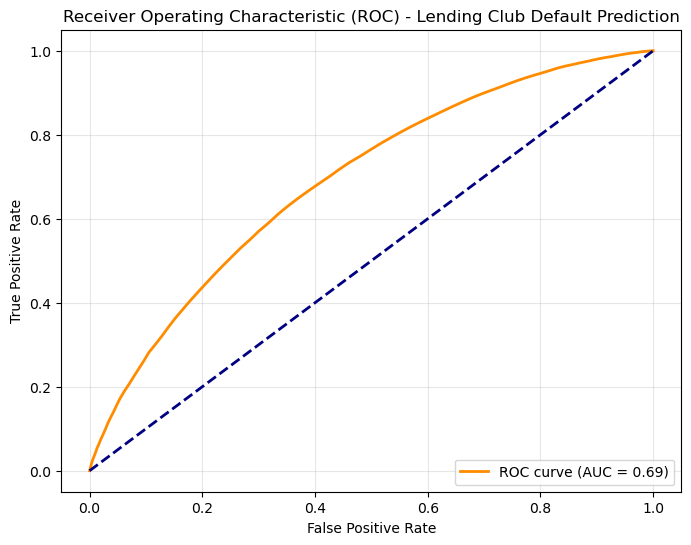
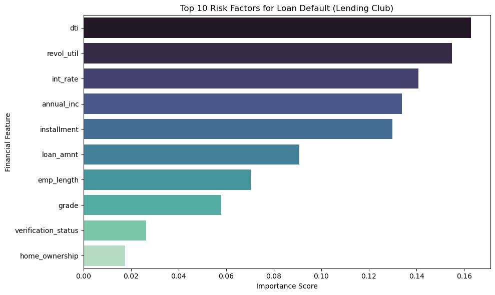

# Credit Risk Prediction (Lending Club)

Predicting whether a Lending Club loan will default, using 2.2 million historical loans, a Random Forest classifier, and under-sampling to handle class imbalance.

## Dataset

[Lending Club loan data](https://www.kaggle.com/datasets/adarshsng/lending-club-loan-data-csv) from Kaggle: 2,260,668 loans and 145 columns. The notebook downloads it with `kagglehub`.

- **Target:** 1 = Charged Off or Default, 0 = Fully Paid. Loans that are still running are removed.
- **Features:** loan amount, term, interest rate, installment, grade, employment length, home ownership, annual income, verification status, debt-to-income ratio (DTI), and revolving credit utilization.

After cleaning, 1,227,405 finished loans remain, and only about 20% of them are defaults:

| Fully Paid | Default |
|---:|---:|
| 986,272 | 241,133 |

## Approach

1. Drop columns with more than 30% missing values, then keep 11 standard credit features.
2. Remove rows with missing values and label-encode the categorical columns.
3. Balance the classes by randomly under-sampling the fully paid loans to 241,133, so both classes are the same size.
4. Split 80/20 (stratified) and train a Random Forest with 100 trees.
5. Evaluate with precision, recall, and ROC-AUC, then check which features the model relies on.

## Results

Before balancing, the model reached 80% accuracy but caught only 7% of defaults (recall 0.07), because it mostly predicted "Fully Paid". After balancing:

| Metric | Value |
|---|---:|
| Recall (defaults) | 0.65 |
| Precision (defaults) | 0.64 |
| Accuracy | 0.64 |
| ROC-AUC | 0.69 |

The test set is also balanced, so precision on real data, where defaults are rarer, would be lower.



## Most important features

DTI, revolving utilization, interest rate, annual income, and installment amount have the most influence on the model's predictions.



## Run it

```bash
pip install -r requirements.txt
jupyter notebook credit_risk_lendingclub.ipynb
```

The first run downloads the full dataset from Kaggle, so it takes a while.

## Tools

Python, pandas, NumPy, scikit-learn, Matplotlib, Seaborn, kagglehub
